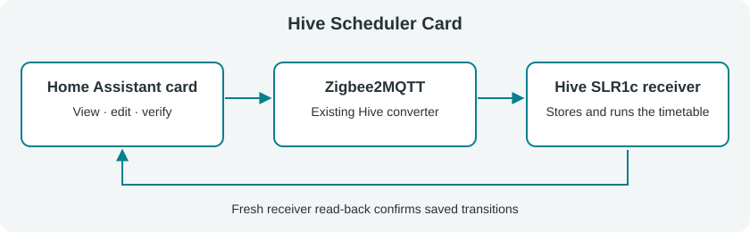

# Hive Scheduler Card

A Home Assistant dashboard card for the **native heating schedule stored on a Hive SLR1c receiver**, through Zigbee2MQTT. The receiver executes the timetable; Home Assistant provides the editor and MQTT transport. No custom integration or Schedule Helper is required.



Derived from [abaddon's Sonoff TRVZB Scheduler Card](https://github.com/abaddon/ha_sonoff_TRVZB_scheduler_card). The original MIT licence and Copyright (c) 2024 abaddon are preserved in [LICENSE](LICENSE) and the compiled card.

## Requirements and validation status

- Hive SLR1c with the working external converter exposing seven writable text properties, `schedule_monday` through `schedule_sunday`, `/get` support, and receiver-originated schedule responses. It must not optimistically publish requested schedules as confirmed state. The converter is not bundled or modified by this card.
- Zigbee2MQTT Home Assistant discovery and Home Assistant's MQTT integration, using base topic `zigbee2mqtt`.
- Home Assistant 2024.1 or newer. Viewing requires entity access. **Verified saving requires a Home Assistant administrator**, because HA's MQTT listener requires administrator permissions.
- Temperatures: **1°C off**, or **5–32°C in 0.5°C steps**. One to six chronological setpoints per day, with every minute supported.

The owner has hardware-tested the converter and confirmed the card's complete end-to-end hardware acceptance on 29 October 2026. No production release has been published for this implementation.

## HACS installation

Install this repository as a custom HACS Dashboard repository:

1. Open HACS → menu → **Custom repositories**.
2. Add `https://github.com/sultanhq/ha_hive_scheduler_card`, category **Dashboard** (`plugin` in older interfaces).
3. Download **Hive Scheduler Card** from the default branch and reload the frontend.
4. Verify resource `/hacsfiles/ha_hive_scheduler_card/hive-scheduler-card.js`, type **JavaScript module**, under Settings → Dashboards → Resources. Add it manually if HACS has not registered it.

The compiled file is committed under `dist/`, so a GitHub release and inclusion in the main HACS catalogue are unnecessary. Install from this repository's `main` branch.

## Manual development installation

1. Download `dist/hive-scheduler-card.js` from branch `feat/hive-slr1c-scheduler`, or unzip the `hive-scheduler-card` artifact from a successful branch CI run.
2. Copy the file to `/config/www/hive-scheduler-card.js` in Home Assistant.
3. Register `/local/hive-scheduler-card.js?v=hive-dev-1` as a **JavaScript module** resource. Increment the version query after replacing the file and reload the browser.
4. Add the configuration below. Load only one copy of the card's resource; HACS and manual installation are alternatives.

## Configuration

```yaml
type: custom:hive-scheduler-card
entity: climate.hive_reciever  # illustrative: select your actual entity
 # mqtt_device: "Hive Reciever"  # optional exact topic name override
name: Hive Heating
view_mode: week              # week (default) or graph
```

The visual editor keeps text entry stable during live Home Assistant updates and commits text fields when you finish editing (on change), rather than on every keystroke.

`entity` (the stable `climate.*` entity ID) is required. `mqtt_device` is an **optional override**: the card discovers the exact receiver MQTT state topic from Home Assistant MQTT device metadata, never by guessing from changing friendly-name labels. Discovery requires an administrator; if discovery is unavailable or ambiguous, supply the exact Zigbee2MQTT topic name as `mqtt_device`. Wildcards, `/`, and control characters are rejected. `name` only controls the card title.

Schedule text entities are discovered through the climate entity's HA device and MQTT schedule identifiers. Renamed entities work independently of the climate entity ID. If discovery is missing or ambiguous, configure overrides in YAML or the visual editor:

```yaml
type: custom:hive-scheduler-card
entity: climate.actual_hive_entity
mqtt_device: "Hive Reciever"
name: Hive Heating
view_mode: graph
schedule_entities:
  monday: text.actual_monday_entity
  tuesday: text.actual_tuesday_entity
  wednesday: text.actual_wednesday_entity
  thursday: text.actual_thursday_entity
  friday: text.actual_friday_entity
  saturday: text.actual_saturday_entity
  sunday: text.actual_sunday_entity
```

Overrides may be partial; discovery resolves the remainder. Each day needs a different `text.*` entity.

## Editing and verified saving

Click a day to edit setpoints, or drag stored graph points. Each setpoint sets a temperature from a particular time. The first point is editable and deletable; retain at least one point. Choose **Heating off (1°C)** for an off period. Graph lines use the same temperature colours as their points and the timetable, including the dashed overnight period. Temperatures below 10°C are blue, 10–15°C are green, and warmer values gradually move through yellow into near-red at 20–25°C, then pure red above 25°C. Slider tracks share this palette on the 5–32°C heating scale, and their thumb outlines match the selected temperature. Labels sit beside graph steps, with a background outline to keep crossing lines clear of the text. Use **Copy to Other Days** to copy a day's schedule.

Schedules may begin after midnight. A dashed graph segment before the first setpoint shows the previous day's final temperature, including weekly wraparound. Hover over this segment or its open start marker to see the temperature, time interval, and previous day—for example, “00:00–06:00: Heating off (1°C), carried over from Sunday”. It has no editable point and is never written. Identical duplicate padding is collapsed; different schedule times with equal temperatures remain distinct.

Save validates the draft and publishes only changed days:

```text
Topic: zigbee2mqtt/Hive Reciever/set
Payload: {"schedule_monday":"06:00/21 19:30/1"}

Topic: zigbee2mqtt/Hive Reciever/get
Payload: {"schedule_monday":""}
```

**Verifying…** remains visible until fresh, non-retained feedback and the associated HA entities agree with the intended schedule. Duplicate padding and formatting differences are ignored. Read requests retry at 10 and 20 seconds with a 30-second read-back deadline. Individual HA calls time out after five seconds. Writes are never automatically repeated.

Errors preserve your draft. Confirmed days are tracked on partial failure; check connectivity and Zigbee2MQTT logs before retrying. External changes to an edited day block saving until you explicitly **Discard edits and reload**. This discards the draft and requests all seven schedules without writing schedules.

The native protocol has no transaction ID; verification relies on the supplied converter's receiver responses and a fresh read-back window. A multi-day save is not atomic. Avoid other controllers editing schedules during acceptance testing.

Missing entities and malformed, unordered, conflicting, or unsupported schedules show errors. The card never substitutes defaults or rounds existing unsupported values. It deliberately restricts temperatures to half-degree steps, even if a converter accepts finer precision.

## Hardware acceptance

First display all seven days against the actual HA text entities. **Refresh** sends read-only `/get` requests.

After explicit approval for a hardware write:

1. Back up the exact original text state for one day.
2. Change one temperature by 0.5°C, save, and wait for verification.
3. Confirm the value on the physical Hive remote and record the result.
4. Restore the backup and verify read-back and remote display.
5. Back up a target day, test copying to it, then restore and verify it.

The owner confirmed completion of this hardware acceptance procedure on 29 October 2026. The procedure above remains available for future installation checks. Production publication is a separate action.

## Development

Use Node.js 24.15+ on the 24.x line (`nvm use` reads `.nvmrc`), or Node.js 26+. This is a development requirement; the installed card runs in the Home Assistant browser.

```sh
npm ci
npm test
npm run typecheck
npm run build
git diff --exit-code -- dist/hive-scheduler-card.js
```

Rebuild and commit the JavaScript alongside source changes. CI verifies the committed build and uploads an artifact; other generated files remain ignored. Serve this repository locally and open `test-component.html` for a mock preview that never contacts hardware.

Tag-triggered release automation creates **draft releases only**. Optional inherited Claude automation requires repository variable `ENABLE_CLAUDE_AUTOMATION=true` and its credentials.

See [development validation](docs/development-validation.md) for baseline results, dependency findings, and hardware status.

For inclusion in HACS’s default catalogue, see the [submission guide](docs/hacs-submission.md). Custom-repository installation already works; default inclusion also requires a published GitHub release and a PR to `hacs/default`.


## Hive Boost Card (second HACS dashboard card)

The HACS installation includes **two separate Lovelace card types** in the same
`hive-scheduler-card.js` resource:

- `custom:hive-scheduler-card`: edit the native seven-day timetable.
- `custom:hive-boost-card`: temporarily override the heating setpoint.

After updating the HACS dashboard package, reload the Home Assistant frontend
and select **Hive Boost Card** in the Add Card dialog. Use the visual editor to
choose the stable `climate.*` entity ID. The exact Zigbee2MQTT topic name is automatically discovered; use the optional override only if discovery fails.
The boost card does **not** require the seven schedule text entities.

```yaml
type: custom:hive-boost-card
entity: climate.hive_reciever  # select the actual climate entity
 # mqtt_device: "Hive Reciever"  # optional exact topic name override
name: Heating Boost
default_temperature: 21      # fallback only when room temperature is unavailable
default_duration: 60
```

### Controls and safety

1. The suggested temperature is **room temperature +1°C**, rounded up to the next **0.5°C** step and limited to **5–32°C**. You can adjust it with the slider. The suggestion follows room readings until you adjust it or open confirmation; your selected/confirmed value then stays stable. If the room temperature is unavailable, `default_temperature` is used as a fallback (21°C if unset).
2. Select **15, 30, 60, 90, 120, 180 or 360 minutes**, or enter a custom
   whole-minute duration from 15–360.
3. Select **Boost**, review the proposed temperature and duration, then
   **Confirm Boost**. Cancel/Back performs no write.
4. The card sends **one unretained MQTT message** to
   `zigbee2mqtt/<FRIENDLY_NAME>/set` containing the four receiver fields:
   ```json
   {"system_mode":"heat","occupied_heating_setpoint":21,"temperature_setpoint_hold_duration":60,"temperature_setpoint_hold":true}
   ```
5. The card waits for non-retained receiver feedback to report that the hold
   and setpoint agree with the request. A publish acknowledgment alone
   is **not** displayed as success.
6. While a hold is active, **Cancel Boost** sends
   ```json
   {"system_mode":"auto","temperature_setpoint_hold_duration":0,"temperature_setpoint_hold":false}
   ```
   to release the hold and return to automatic scheduling.

The Boost card never changes `schedule_monday` through `schedule_sunday`.
The finite hold duration is stored in the receiver, not a browser countdown.
An existing manual/indefinite hold is shown as such rather than mislabelled as
a timed boost. The sentinel **65535 is never used for a new Boost**.

Like schedule editing, receiver control needs a Home Assistant administrator
and a working MQTT integration. The Boost card also needs live Zigbee2MQTT
state messages to verify a change. A failure to receive feedback is reported
as **unconfirmed**, rather than encouraging repeated automatic writes.

**Hardware acceptance:** The original scheduler has been hardware-tested.
The Boost card's new set/stop behaviour requires separate acceptance testing
on the actual Hive SLR1c + SLT3C setup, particularly the automatic return
to timetable when the duration expires. Start with a 15-minute boost and
verify the remote display, receiver feedback, expiry, and manual cancellation
before relying on it for unattended heating. The SLR1c exposes only
`off`, `auto` and `heat` system modes, unlike some older Hive variants
which document `emergency_heating`.

### Local Boost preview

Run `npm ci` and `npm run build`, then serve the checkout with `python3 -m http.server 8124 --bind 127.0.0.1`. Open [the mock preview](http://127.0.0.1:8124/test-component.html#boost-desktop) and scroll to the desktop/mobile Boost cards. This page has no Home Assistant connection and never writes hardware.

The preview defaults to a 15-minute boost. Select **Boost**, review and **Confirm Boost**, then try **Cancel Boost**. **Advance mock by 1 minute** tests receiver expiry without waiting in real time. The **Boost feedback** selector simulates retained-only feedback, wrong system mode, or no feedback; **Send room temperature only** demonstrates that unrelated updates cannot confirm a command. Switch back to normal feedback and use **Read mock receiver** for a fresh response.

Verification requires fresh non-retained command fields: hold, finite duration, setpoint and `heat` mode for a start; cleared hold, zero duration and `auto` mode for cancellation. Cached display data cannot confirm either operation.

## Hive Boost Badge

Use **Hive Boost Badge** in the dashboard’s **Add badge** picker to place Boost at the top of a view. It uses the same `hive-scheduler-card.js` resource as the scheduler and Boost card; no second resource is needed. After updating through HACS, refresh the browser to load the new badge type.

The compact badge shows room temperature while idle, **Boost active** and the receiver’s remaining minutes during a timed boost, and **Verifying…** while a command is pending. Tap it to open the existing Boost controls. Opening or closing the popup does not send a heating command; starting a boost still requires **Boost → Confirm Boost**. Closing the popup while verification is pending lets verification finish in the background.

Configure it with the same climate entity and exact MQTT receiver name as the Boost card:

```yaml
badges:
  - type: custom:hive-boost-badge
    entity: climate.hive_reciever
    mqtt_device: "Hive Reciever"
    name: Heating
    default_duration: 30
```

The visual editor supports the same settings, including the 15-minute minimum and fallback temperature. The initial suggestion remains room temperature +1°C, rounded up within 5–32°C. Receiver countdowns below 15 minutes are displayed normally. Viewers can see room temperature and open read-only controls; MQTT subscriptions and Boost commands require an administrator.

Close the popup using its close button, Escape, or the backdrop. The badge follows the dashboard theme and supports keyboard focus. The [local mock preview](http://127.0.0.1:8124/test-component.html#badges) includes the badge alongside both cards and the simulated feedback/expiry controls.

Home Assistant references: [custom badges](https://contributors.home-assistant.io/frontend/custom-ui/badge/), [dashboard badges](https://www.home-assistant.io/dashboards/badges/).
